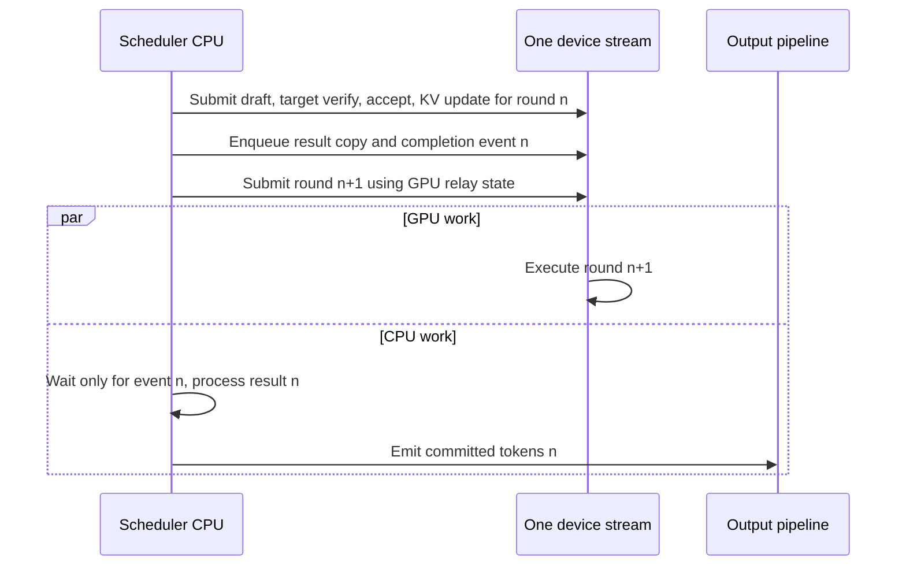
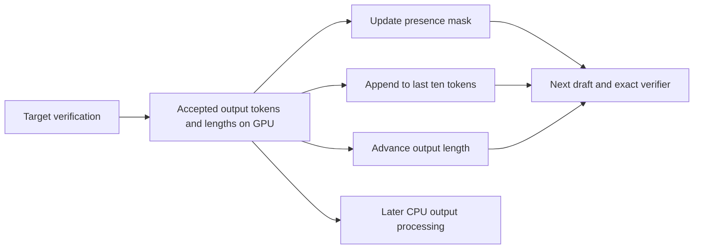

# Speculative decode overlap

This change implements the shared scheduling step in [Speech Spec roadmap 2941](https://github.com/sgl-project/sglang-omni/issues/2941). It builds on the native-worker integration in [2937](https://github.com/sgl-project/sglang-omni/pull/2937), the CosyVoice3 sampler in [2938](https://github.com/sgl-project/sglang-omni/pull/2938), and the Qwen3-Omni integration in [2939](https://github.com/sgl-project/sglang-omni/pull/2939).

The scheduler submits the next speculative round before processing the preceding round's CPU result. Native workers still own proposal, verification, acceptance and KV updates. The option defaults to off until accelerator validation is complete.

## Scope and ownership

| Layer | Responsibility |
| --- | --- |
| OmniScheduler | Select batches, relay device inputs, retain pending results, process committed output, cancel and drain |
| SGLang native V2 worker | Draft proposal, target verification, acceptance, target and draft cache updates |
| Model runner | Model-specific prefill hooks and conversion of committed outputs into pipeline chunks |
| CosyVoice3 RequestHistories | Committed output presence, length and recent-token window used by its exact sampler |
| Stage | Existing inbox, outbox and downstream routing |

There is no Qwen-specific scheduling loop. Qwen DFlash, Qwen EAGLE3 and CosyVoice3 DSpark enter the same scheduler path. A future model with a compatible native worker can use it; its sampler must obtain changing decode state from device-owned committed state. This does not add drafts for unsupported models or speculative support for multi-codebook talkers. Ordinary autoregressive runners keep their existing async-decode path. CosyVoice3 retains the base PR's TP1-only restriction.

## What overlaps

A speculative round contains dependent operations. Target verification cannot precede its draft proposal. What can run concurrently is GPU work for the next round and CPU processing of the previous result.



The initial implementation uses one device stream for forward, result copies and cache operations. This keeps shared-buffer reads and subsequent writes ordered without adding another consumer or another set of cross-stream fences. D2H copies remain in this stream and can delay the next GPU round. A separate copy stream is a follow-up only if traces show that delay is material.

The main changes relative to the synchronous loop are:

1. Resolve accepted sequence lengths and next inputs through the native FutureMap. Attention backends that declare device-only sequence lengths avoid the old per-round host length copy. Backends requiring CPU lengths keep the native fallback.
2. Run the existing native worker inside its forward isolation context. Retain the native two-iteration batch snapshots and any extra worker references.
3. Stash the next draft input before result tensors are copied to the CPU. Device inputs and CPU reporting copies have different consumers.
4. Retain one result between iterations. After submitting the next round, process the older result with the native result processor. Temporarily two results exist during this handoff.
5. Process prefill in its own iteration. Drain pending decode results before expected prefill selection and again at a prefill boundary. This preserves model hooks that read the number of unfinished middle chunks.

Prefill and grammar-dependent batches use synchronous result processing. A rank participating in another rank's prefill also takes this boundary through is_extend_in_batch. Mixed prefill/decode batches and retained sessions remain excluded by the base PR. Pipeline parallelism greater than one is rejected for this loop.

## Why CosyVoice3 needs a model change

CosyVoice3 uses repetition penalties, a minimum output length, and repetition-aware redraw over its most recent ten tokens. The previous implementation rebuilds these inputs from CPU output_ids each round. With lookahead, that list is one accepted block behind. Merely turning on the scheduler would therefore change the distribution being verified.

RequestHistories now owns all three changing quantities on the device. After verification it appends exactly the valid accepted output prefix, including the bonus token. Rejected proposals and padded columns do not enter history. Batch rows gather history by stable request-pool slot, so batch reordering does not swap histories.



Initial history is loaded from CPU after synchronous prefill, including its first sampled token. Any subsequent prefill invalidates the slot's history. A new request identity also initializes the slot afresh. The exact acceptance formula, target distribution and vocoder interface are unchanged. Device history is used by both synchronous and overlap execution so there is only one sampling-state implementation to maintain.

The presence update reduces 0/1 bytes through a uint8 view of the boolean storage. This avoids a copy and uses a dtype supported by CUDA scatter reduction. Padding may alias a real token index, so the reduction must preserve an existing true bit.

Updating history adds tensor operations and touches a presence row of 6,761 booleans per request. Whether reducing host work outweighs these added launches is a required accelerator measurement, especially at batch one.

## Correctness boundaries

| Situation | Handling | Validation still needed on an accelerator |
| --- | --- | --- |
| EOS or maximum output length | Native result processing trims the committed prefix; a previously submitted extra round is discarded for finished requests | No duplicate token, hidden state or speech chunk; no double free |
| Slot reuse and batch compaction | FutureMap uses request slots; CV history initializes on prefill or identity change | Rapid cancel and reuse with allocator checks |
| Retraction and re-prefill | Pending results remain visible to lifecycle scans; prefill resets CV history | KV pressure, partial cache hits and chunked prefill |
| External cancellation | Queue it onto the scheduler thread while overlap is active; existing deferred cleanup remains in force | Cancellation during proposal, verify, copy and host emission |
| Pause | Resolve pending overlap results before aborting or retracting requests | All pause modes and resume |
| Stop | Scheduler thread retains shutdown ownership and drains submitted device work | Slow forward during stop; stage join timeout |
| Forward exception | Propagate to the scheduler exit path; drain before resource cleanup | Fault injection after partial submission |
| Device drain failure | Do not invoke the scheduler resource-release callback; stage restart is required | Process-level failure containment |
| Grammar | Resolve preceding CPU state and run the batch synchronously | Grammar-constrained native-worker cases |

CPU output completion is not a general proof that all future GPU users are retired. During normal operation, same-stream ordering protects later cache writes/reuse and native snapshots preserve tensor lifetime. During shutdown, explicit stream synchronization provides the retirement boundary. The implementation introduces no independent first-token publisher.

The existing allocator already reserves two worst-case verification windows. This change preserves that reservation rather than doubling it again. Visible tokens still pass through the native finish/stop handling and Omni's existing committed-token emitter.

## Relation to other engines

| Engine | Relevant design | Decision here |
| --- | --- | --- |
| [SGLang v0.5.21](https://github.com/sgl-project/sglang/blob/v0.5.21/python/sglang/srt/managers/scheduler.py) | Native V2 workers, FutureMap, transactional forward state, retained batch snapshots, process the previous result after submitting the next batch | Reuse the same worker and result contracts. Keep one stream initially instead of porting the entire scheduler and its optional features |
| [vLLM new runner](https://github.com/vllm-project/vllm/blob/2b85d9cb65c1f56c347cb7f56f1596a6b8b28373/vllm/v1/worker/gpu/model_runner.py) | Creates asynchronous output before speculative proposal, separates GPU request state from host output and starts the output copy early | Preserve separate device relay and CPU result ownership. Independent copying and early publication remain separate optimizations |
| [DeepInfer worker](https://github.com/deepseek-ai/DeepInfer/blob/8b16149741a4935e1dec8cea27853f273b374c5b/deepinfer/worker/worker.py) | Launches current target forward before processing the preceding CPU result; uses device-corrected lengths and stable request identity; handles prefill immediately | Adopt the ordering and state-ownership principles. Keep Omni's online cancellation and shutdown obligations |

This is a tradeoff, not a claim that one stream is universally fastest. Separate schedule and copy streams can remove additional device dependencies, but require an audit of shared-buffer read completion, copies, tensor lifetime and allocator mutation. The first comparison should establish how much CPU time the simpler loop hides; subsequent changes need an exposed gap to justify their maintenance cost.

## Historical evidence and estimated benefit

The following is an older single-H200, TP1/DP1, FP8 Thinker experiment: streaming MMMU validation, 900 requests, closed-loop concurrency 16. C2 includes early token publication; C3 adds the previous overlap implementation. It is not a measurement of this branch or Wilson's current stack.

| Metric | Historical C1+C2 | Historical C1+C2+C3 | Change |
| --- | ---: | ---: | ---: |
| Output tokens/s | 1486.764 | 1990.693 | +33.89% |
| E2E mean seconds | 5.630 | 4.197 | -25.45% |
| Request mean TPOT, mean milliseconds | 11.717 | 9.043 | -22.82% |
| Request mean TPOT, p50 milliseconds | 11.564 | 8.844 | -23.52% |
| Request mean TPOT, p90 milliseconds | 15.347 | 12.048 | -21.50% |
| Request mean TPOT, p99 milliseconds | 24.699 | 23.056 | -6.65% |
| Client text TTFT mean milliseconds | 286.399 | 289.387 | +1.04% |
| Client text TTFT p50 milliseconds | 193.854 | 211.485 | +9.10% |
| Client text TTFT p90 milliseconds | 446.591 | 465.252 | +4.18% |
| Client text TTFT p99 milliseconds | 1712.937 | 1425.065 | -16.81% |

Historical source commits were 423df89eee55 for C1+C2 and 678ded2f19f2 for C1+C2+C3.

Actual output counts differed: 473,486 versus 473,352 tokens. Native/strict quality counts were 583/580 versus 603/594 out of 900. Neither the small work difference nor higher quality counts establishes identical generation trajectories or proves that the new code is lossless.

One recorded batch-four trace contained 1.115 ms of host result processing, of which 1.010 ms overlapped the next round's kernels. That round's kernel union was 8.556 ms. Kernel union is not round duration; dividing those numbers does not predict end-to-end speedup.

A useful conditional model is:

- Let G be the GPU round duration including necessary copies, C the CPU result processing time, and P the remaining exposed preparation/submission time.
- Without overlap, approximate round time as P + G + C.
- With ideal overlap, approximate it as P + max(G, C), plus any new history-update and synchronization costs.
- The maximum removed time is bounded by min(G, C). If G=10 ms, C=1 ms, P=1 ms, ideal round time falls from 12 to 11 ms: about 9.1% more rounds/s. These inputs are illustrative, not measurements.

The roadmap's 1–4% synchronous-loop cost is specific to its measured workload. It does not cap the benefit for long decode workloads. Likewise, the historical 33.89% cannot be assigned to CosyVoice3 or the new code. Prefill-heavy ASR and downstream-vocoder-heavy speech have less end-to-end room. This loop does not remove DFlash's prefill work, so it does not promise an isolated TTFT reduction; any service-level TTFT improvement would mostly come from reduced queueing.

## Enabling and reviewing

Set enable_overlap: true in the generation stage's factory_args. Qwen's speculative factory turns off ordinary enable_async_decode and aligns the native scheduling flag. CosyVoice3 forwards the same option through its builder. Direct scheduler callers must set enable_async_decode=False and disable_overlap_schedule=False. The default remains false.

Review the shared scheduler before the model adapters. The key paths are run_speculative_batch, event_loop_overlap, resolve_pending_overlap, start, stop and the request lifecycle scans. For CV, review RequestHistories, build_step_sampling_state and the worker's verified-result commit. The model factories only wire the option.

This checkout combines the three open PR heads as a local integration baseline. Review only the diff against feat/speculative-overlap-base. Before stacking publicly, update the baseline to the author's then-current heads and rerun integration checks. No external PR operation is required to review this local implementation.

## Validation plan

Normal integration commands in a compatible SGLang environment:

```bash
pytest tests/unit_test/pipeline/test_scheduler.py tests/unit_test/fun_cosyvoice3/test_speculative.py -q
pre-commit run --all-files
```

The initial local CPU checks execute the actual history, sampling and scheduling method bodies without importing the unavailable CUDA extension. They cover distributions, delayed host history, padding, row permutations, slot reuse, re-prefill, launch-before-commit order, prefill drains and shutdown failure order. They are supplemental CPU contracts, not a replacement for the normal import/integration suite or CUDA execution.

For a later single-H200 two-hour session, preload checkpoints and datasets before the reservation. Freeze dependency, model revisions, dtype, graph settings and client arrival schedule. A is this stack with overlap disabled; B is the same stack with overlap enabled. Compare against main separately; it cannot isolate overlap.

| Time budget | Work |
| --- | --- |
| 0–15 minutes | Environment manifest, native unit tests, off/on smoke, allocator checks |
| 15–45 minutes | CV paired fixed-work B1/B8/B16/B64 tests; exact sampler state checks; cancellation/reuse; two short traces and streaming speech sanity |
| 45–60 minutes | Load Qwen and verify the same model/backend settings in A and B |
| 60–85 minutes | Qwen fixed-length short/long decode pairs at small/moderate concurrency; mixed arrivals; prefill/verify/copy/CPU traces; stop/retraction tests |
| 85–115 minutes | One complete paired MMMU900 comparison; repeat only if the remaining time permits a complete pair |
| 115–120 minutes | Export raw results, traces and environment hashes; release the GPU |

Full ASR2620, repeated full-dataset quality, EAGLE3, TP2 and DP attention require additional time if they do not fit. Do not reduce them to a tiny cohort and label that full coverage.

Record both actual work and user-visible outcomes: generated tokens, accepted/verified tokens, padding rows, request throughput, token throughput, E2E/TTFT/TPOT/ITL mean/p50/p90/p95/p99, speech first-chunk latency and chunk gaps, peak memory, and dataset quality. Separate fixed-work mechanism tests from freely terminating quality tests. For CV stochastic sampling, identical seeds are not a guarantee of identical output sequences; the roadmap's position-keyed RNG work remains separate.

In each trace, measure CPU preparation, CUDA submission, proposal, target verify, acceptance, draft cache update, CV history update, D2H, and CPU output processing. Report GPU idle gaps and the intersection of CPU processing with subsequent GPU work. If D2H remains a substantial exposed interval, a separate copy stream becomes a concrete next experiment. If native forward submission dominates, changing the output consumer cannot remove that cost.
